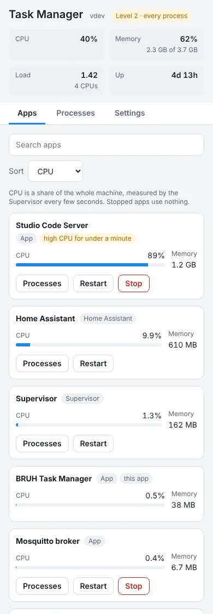

import { Steps, Aside } from '@astrojs/starlight/components';

In about a minute you have every app's CPU and memory in the sidebar. Sensors and the
process view are optional.

## Before you start

You need Home Assistant OS or Supervised, 2023.6 or newer, on a 64-bit machine (`amd64` or
`aarch64`).

## Install

<Steps>

1. **Add the repository.** Go to **Settings → Add-ons → Add-on Store → ⋮ → Repositories** and
   add:

   ```text title="Repository URL"
   https://github.com/bruhautomation/BRUH-HA-Apps
   ```

2. **Install BRUH Task Manager** and press **Start**.

3. **Open Task Manager** in the sidebar. It is admin-only.

</Steps>

The **Apps** tab lists every app, Home Assistant, the Supervisor and its plugins, busiest
first. That is Level 1. There is nothing else to set.



## Add the sensors (optional)

<Steps>

1. **Restart Home Assistant once**, so it loads the `bruh_task_manager` integration the app
   deployed.

2. Go to **Settings → Devices & services**. **BRUH Task Manager** is under *Discovered*.
   Press **Add**.

</Steps>

A *BRUH Task Manager* device appears with **CPU**, **Memory used**, **Busiest app**,
**Busiest app CPU** and **Runaway app**.

## Turn on Level 2 (only when you need it)

Level 2 shows every process on the machine. It needs Protection mode off on this app. Read
[what turning Protection mode off does](/bruh-task-manager/guide/#what-turning-protection-mode-off-does)
first. The Settings tab says the same before you change anything.

<Steps>

1. On the **Settings** tab, switch on **Show every process**.

2. Press **Open the add-on's Info page** and turn **Protection mode** off. Only you can do
   this. An app can't change its own Protection mode.

3. **Restart** the app. Protection mode takes effect when it starts.

4. Go back to **Settings**. All three steps are ticked, and the **Processes** tab lists
   every process, grouped by app.

</Steps>


<Aside type="tip" title="When you're done">
Switch **Show every process** off and turn **Protection mode** back on. With Protection mode
off and Level 2 switched off, the app reads nothing. It says so on the Settings tab and in
its log.
</Aside>

## Next

[Guide & Reference](/bruh-task-manager/guide/) covers Restart and Stop, End process, the
runaway rule, every option and sensor, and an automation that restarts a runaway app.
