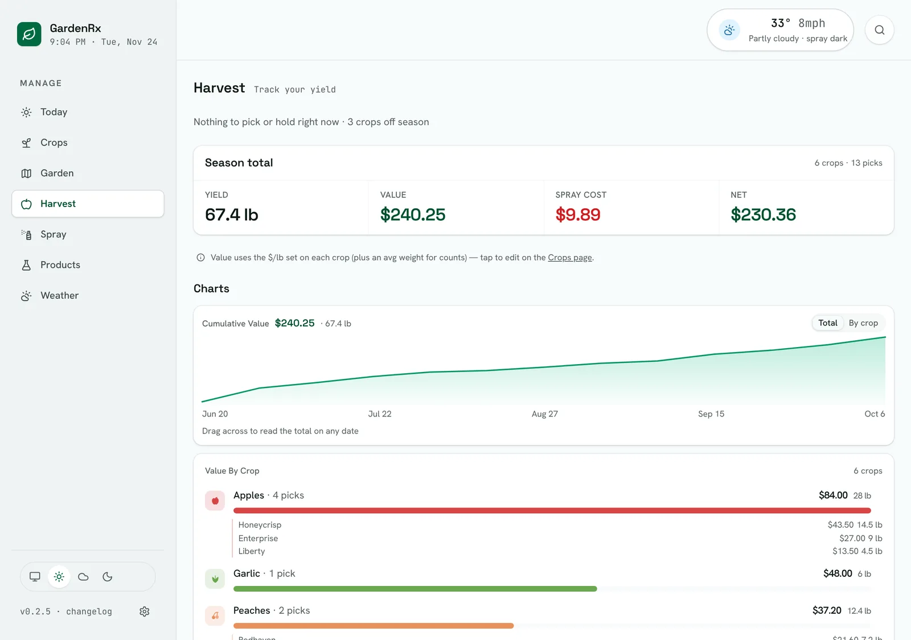

import { Aside, Card, CardGrid } from '@astrojs/starlight/components';

GardenRX opens in the Home Assistant sidebar. On a computer the screens are in a sidebar
of their own, with the clock, the theme switch (Auto, Light, Medium, Dark), the version
and a link to the in-app changelog at the bottom; on a phone they become a bottom bar of
seven: **Today, Crops, Garden, Harvest, Spray, Products, Weather**. The current weather
sits in the top bar on every page, with a search that finds any crop or product.

## Today

The first page answers one question: *does anything need doing?*

- **The banner** says it in one line — *All crops protected*, a spray that is due, or
  *Hold off* with the reason — with the temperature and wind now. When it says to hold
  off, it names the next good spray window with its day and time, never the hour already
  under way, and the Weather page gives the same answer.
- **Needs attention** lists crops whose fungicide or insecticide cover has run out, and
  crops ready to pick. A row opens the Spray page's planner with that crop already ticked.
  "Fungicide due" and "Ready to pick" count only crops in season; a crop picked in the
  last two weeks still counts as ready.
- **Don't harvest yet** — crops inside a pre-harvest interval, with the days left. This is
  never hidden.
- **Queued sprays**, each with its products and rates, how long its coverage will last,
  and **Log Spray**.
- **Watering advice** and a one-line rain summary that links to Weather.

**Out of season** the page changes. *While the garden rests* shows a frost warning when a
freeze is forecast, each crop's stage and when it usually wakes ("Bud Break is typically
around Feb 26") with what to do meanwhile, the last spray and the last pick. Watering tips
stop while nothing is growing.

## Crops

Every crop you grow, grouped as **Orchard** and **Garden**, each one compact row with its
stage, its varieties, and — while it is in season — when its next spray is due
("Fungicide: next due Dec 3"). Filter by area, search, and sort by priority.

### The season

Each crop belongs to a **crop group** (Pome Fruit, Stone Fruit, Berries, Grapes,
Cucurbits, Nightshades, Leafy Greens, Brassicas, Legumes, Alliums, Root Vegetables, Herbs,
Ornamentals, Turf, Pawpaw…), and each group has a **phenology calendar**: the stages of its
year and their usual dates — dormant, silver tip, bud break, bloom, petal fall, green
fruit, harvest, post-harvest.

- A variety's stage **follows the date**. A past-season crop reads *Dormant* in November,
  not *Bud Break*. A garden south of the equator reads its own season.
- You can **set a stage by hand** (a late spring, an early bloom). It gives way to the
  calendar once that stage's season is over.
- **Annual crops** at the end of the season read *Finished for the year*; garlic and
  shallots, in the ground over winter, read *Dormant*. A crop with no varieties (roses,
  shrubs) follows its group's season.
- **Resting crops** (dormant or past harvest) never show a red "lapsed" and never count as
  due. Crops, Today and Harvest ask one rule what is due, so they always agree.

### A crop's page

Open a crop for its varieties and their stages, a stage timeline, its spray coverage,
its harvest windows, its $/lb (and average weight each, for crops you count), and the
**problems to watch for**: the diseases and pests of its group, with symptoms, timing,
the conditions that favour them, and the products labelled against them.

## Garden

A map of your garden. Draw beds, rows and trees in zones, give each a variety and a
colour, and keep **dated notes** on any place — "pruned", "fire blight strike on the
north limb". Notes left with the `gardenrx.log_note` service land here too, one dated line
each, in that place's Edit dialog.

## Harvest

Log picks by weight (lb, oz, kg, g) or by count. The page shows:

- **What to pick now** — crops ready, held by a pre-harvest interval, or still developing;
  when nothing is, one line such as *Nothing to pick or hold right now · 3 crops off season*.
- **Season total** — yield, value, what the sprays cost, and the net.
- **A running chart** of the season's value (drag across it to read any date), by total or
  by crop.
- **Value by crop**, broken down by variety, and every pick in a log you can edit.

A pick's value is its weight times the crop's $/lb; a count is turned into weight with the
crop's *average weight each*. A pick logged inside a pre-harvest interval is saved, and
flagged.

## Spray

The **tank-mix builder** and the spray record, in two tabs.

### Plan a mix

Tick the crops you want to spray. GardenRX shows each crop's **coverage status** (what it
needs: fungicide, insecticide or both), then **recommended mixes** built from the products
labelled for the crops in the selection — drawn from your own stock when you have one.

For each product in a mix you get:

- its active ingredient and **FRAC/IRAC group**, and *Tap to swap* for an alternative;
- a **rate slider** within the label's range for those crops, and the amount to add **to
  your tank** in practical units ("Add 4.3 fl oz to 4 gal tank"), in mL, and its cost;
- for the whole mix, the **total cost** and the **PPE** the labels require.

Before you queue it, the mix is checked against GardenRX's **interlock rules**:

| Rule | What it watches for |
|---|---|
| Tank mix incompatibility | Products that must not go in the same tank |
| FRAC/IRAC rotation, resistance management | The same mode of action used too often in a row |
| Pollinator interlock | Bee-toxic products during bloom |
| Separation interval | Products that need days between them |
| Sulfur high temp | Sulfur above 85 °F, where it burns leaves |
| Captan on pears, copper after bud break on cherries, carbaryl after petal fall, streptomycin outside bloom | Crop- and stage-specific label limits |
| High wind, marginal wind, rain approaching, high or low temperature | The weather in the spray window |

Press **Queue This Spray** to put it on the list (it shows on Today and on the spray
card). When you have sprayed, **Log Spray** records it, clears the queued spray, starts
the pre-harvest clocks and takes what was used out of stock.

### History

Every spray: date, products and rates, crops, the volume, and the weather at the time.
Filter it, and edit or delete a record.

### Coverage and pre-harvest intervals

A spray **covers** a crop for its product's cover interval (10 days for many fungicides; 14
when a label does not say) — and rain beyond what the product tolerates wears it off
sooner. The **pre-harvest interval** (PHI) is the label's minimum days between the last
spray of a product and picking that crop; GardenRX counts it from your logged spray and
shows the date the crop clears.

## Products

### Catalog

The reference that ships with the add-on: **256 products** with their **active
ingredients**, manufacturer and EPA registration number, signal word, **REI** (re-entry
interval), **rain-fast** time, **cover interval**, **rain tolerance**, **temperature
range**, **bee toxicity**, how many times you have used it this season, the **PPE** and
**first aid** from the label, a typical price, and the crops it is labelled for with their
rates and PHIs. Badges say what they are — *REI 24h*, *Re-spray 10d*, or *n/a*.

The catalog is only ever **added to** on an update: a product you edited keeps your edit.

### Your stock

What is on your shelf, by area (Orchard, Garden, Landscape), each with a **level bar** you
drag to set how much is left, and a pencil for its size, count and cost. Anything at **20%
or less** is red, and counts towards the *Treatments running low* sensor. Logging a spray
takes what it used out of stock automatically.

## Weather

Forecast and rainfall for your house's location, from Open-Meteo.

- **The banner** names the next opening — *"Next opening: tomorrow 5–6 pm"* — or says it is
  a good time now.
- **The 3-day spray window**: every daylight hour as a square, *Good to spray*, *Caution*,
  *Hold*, or grey for hours that are over or dark, with the reason under each day ("Hold
  8a–11a below 40° · 1p–4p wind"). The banner's next opening is always the grid's first
  green hour, and nothing ever says it is good to spray in the dark: at night the rating
  reads *Dark*.
- **The 7-day forecast**, with a chip that says when to spray each day — "Spray 3–7 pm",
  "Short 4–5 pm" for a window under three hours, or nothing when no spray is due.
- **Rainfall** this week and over 30 days, days since rain, and a status (*Adequate*,
  *Dry*, *Drought* — drought only in the growing season).
- **Watering advice**. With a quarter inch or more of rain due in the next three days it
  says to wait for the rain; in real heat a *water now* stays when the rain coming is
  less than the soil is short. A resting garden is never told to water now.

### What the window weighs

| | Caution from | Hold from |
|---|---|---|
| Wind | over 8 mph | over 10 mph |
| Rain on the way | within 6 hours | within 2 hours |
| Cold | below 45 °F | below 40 °F |
| Heat | above 90 °F | above 95 °F |

A product's own temperature range and rain-fast time apply on top when it is in the mix.

## Settings

The gear at the bottom of the sidebar.

- **Sprayer** — your tank size in gallons (4 by default, a backpack sprayer). Every dose is
  worked out for it.
- **Appearance** — theme (Auto follows your device; Light, Medium, Dark), and display
  preferences.

## Where your data is

Everything is in one file, `gardenrx.db`, in the add-on's own data folder. It is
**included in Home Assistant backups** and restored with them. Nothing in it is a
credential: the token the integration uses lives in `/config/.gardenrx/api_token` and is
regenerated if it goes missing.

## Location

Forecasts, rainfall and the time of day use the latitude, longitude and time zone set in
**Settings → System → General**. Turn off **Use Home Assistant's location** to use the
location built into GardenRX instead — you will almost always want it on.

## Options

On the add-on's **Configuration** tab:

| Option | Default | What it does |
|---|---|---|
| **Home Assistant integration** (`enable_ha_integration`) | on | Deploy the `gardenrx` integration: the sensors, the `gardenrx.*` services and the cards. Restart Home Assistant once after the first start to load it. |
| **Install the Morph cards** (`install_morph_cards`) | on | When brAIn's Morph dashboard is present (`/config/morph`), copy the cards there on every start as `custom:morph-gardenrx-harvest`, `-spray` and `-inventory`. |
| **Use Home Assistant's location** (`use_home_assistant_location`) | on | Forecast for Home Assistant's latitude, longitude and time zone. Off: the app's built-in location. |
| **Log level** (`log_level`) | `info` | How much the add-on writes to its log while it starts. |

## Security

- The app is reachable only through Home Assistant's ingress, behind its login.
- The integration talks to the app with a bearer token from `/config/.gardenrx/api_token`.
- Every query the screens make is checked against the database schema, table by table and
  column by column, with every value bound — the browser can't send SQL.
- AppArmor is on, and a watchdog restarts the app if its health check (which opens the
  database) stops answering.

## Troubleshooting

<CardGrid>
  <Card title="No GardenRX under Discovered">
    Restart Home Assistant once after the add-on's first start — it has to load the
    integration before it can offer it. Check that **Home Assistant integration** is on
    in the add-on's options.
  </Card>
  <Card title="A card says it can't find its sensor">
    Add the integration (Settings → Devices & services). Each card finds its GardenRX
    sensor by itself; with several, point it at one with `entity:`.
  </Card>
  <Card title="The forecast is for the wrong place">
    Set your home's location in Settings → System → General, and leave **Use Home
    Assistant's location** on. Restart the add-on after changing it.
  </Card>
  <Card title="The log says to restart Home Assistant">
    The integration's code changed with this update. Restart Home Assistant once; card-only
    updates never ask.
  </Card>
</CardGrid>

<Aside type="caution" title="Read the label">
GardenRX is a decision aid. Product labels change, and the label on the container is the
legal word on rates, crops, intervals and protective equipment.
</Aside>
