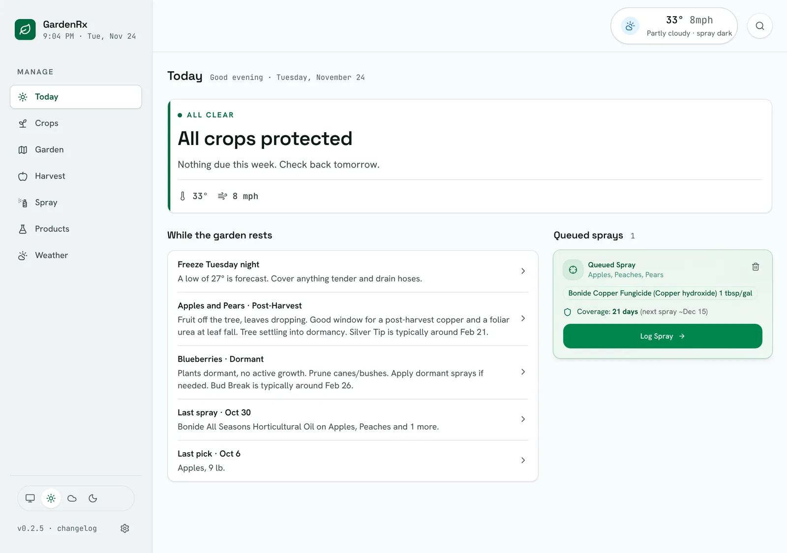
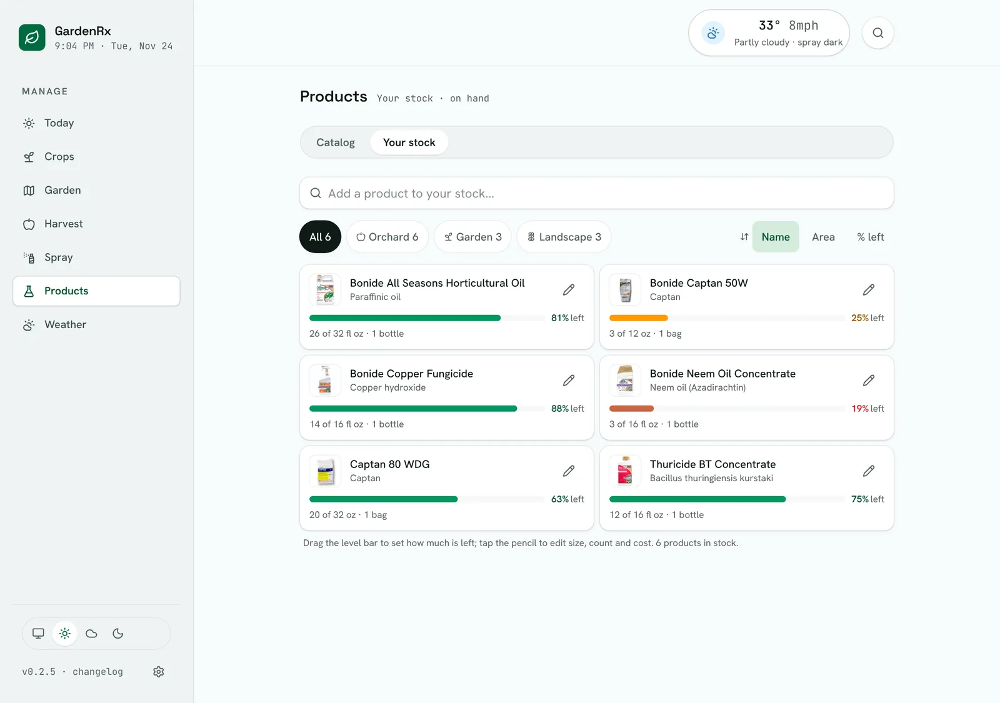

import { Aside, Steps } from '@astrojs/starlight/components';

GardenRX opens from the Home Assistant sidebar and has seven screens: **Today, Crops,
Garden, Harvest, Spray, Products** and **Weather**.

On a phone the screens are a bottom bar. The top bar shows the current weather and a search
that finds any crop, product, disease or ingredient.

## See what needs doing

Open **Today**. It tells you whether anything needs doing right now.

| Section | What it shows |
|---|---|
| **The banner** | *All crops protected*, a spray that is due, or *Hold off* with the reason, plus the temperature and wind now. When it says to hold off, it names the next good spray window with its day and time. |
| **Needs attention** | Crops whose fungicide or insecticide cover has run out, and crops ready to pick. Tap a row to open the planner with that crop ticked. |
| **Don't harvest yet** | Crops inside a pre-harvest interval, with the days left. This is never hidden. |
| **Coming up** | Covers about to run out, with the days left. |
| **Queued sprays** | Each planned spray with its products and rates, how long its coverage will last, and **Log Spray**. |
| **Spray window, 3 days** | The same hour-by-hour window as the Weather page. |
| **Watering and rain** | Watering advice and a one-line rain summary that links to Weather. |

Only crops in season count as due or ready. A crop picked in the last two weeks still
counts as ready.

### In winter

Out of season, **While the garden rests** takes over. It shows a frost warning when a
freeze is forecast, each crop's stage and when it usually wakes ("Bud Break is typically
around Feb 26") with what to do meanwhile, the last spray and the last pick. Watering tips
stop while nothing is growing.

## Check the spray window

Open **Weather** for the forecast and rainfall at your house's location, from Open-Meteo.

| Section | What it shows |
|---|---|
| **The banner** | The next opening, such as *"Next opening: tomorrow 5–6 pm"*, or that now is a good time. It is always the grid's first green hour. |
| **3-day spray window** | Every daylight hour as a square: *Good to spray*, *Caution*, *Hold*, or grey for hours that are over or dark. The reason is under each day ("Hold 8a–11a below 40° · 1p–4p wind"). |
| **7-day forecast** | A chip says when to spray each day: "Spray 3–7 pm", "Short 4–5 pm" for a window under three hours, or nothing when no spray is due. |
| **Rainfall** | This week and the last 30 days, days since rain, and a status: *Adequate*, *Dry* or *Drought* (drought only in the growing season). |
| **Watering advice** | With a quarter inch or more of rain due in the next three days, it says to wait. In real heat, *water now* stays when the rain coming is less than the soil is short. A resting garden is never told to water now. |

Nothing ever says it is good to spray in the dark. At night the rating reads *Dark*.

### What the window weighs

| | Caution from | Hold from |
|---|---|---|
| Wind | over 8 mph | over 10 mph |
| Rain on the way | within 6 hours | within 2 hours |
| Cold | below 45 °F | below 40 °F |
| Heat | above 90 °F | above 95 °F |

A product's own temperature range and rain-fast time apply on top when it is in the mix.

## Plan, queue and log a spray

Open **Spray**. It has two tabs: **Plan a mix** and **History**.

<Steps>

1. **Tick the crops** you want to spray. **Coverage Status** shows what each needs:
   fungicide, insecticide or both.

2. **Read the recommended mix.** It is built from the products labelled for those crops,
   drawn from your own stock when you have one. Each product shows its active ingredient
   and **FRAC/IRAC group**.

3. **Adjust it.** *Tap To Swap* a product for an alternative, or move the **rate slider**
   within the label's range for those crops.

4. **Measure.** Each product shows the amount to add to your tank in practical units ("Add
   4.3 fl oz to 4 gal tank"), in mL, and its cost. The mix shows the total **cost** and the
   **PPE** the labels require.

5. **Press Queue This Spray.** The spray shows on Today, on the Spray page and on the
   spray card.

6. **Press Log Spray** when you have sprayed. This records the spray, clears it from the
   queue, starts the pre-harvest clocks and takes what you used out of stock.

</Steps>

### What the planner checks

A mix that breaks a **Blocks** rule cannot be queued. A **Warns** rule shows a warning and
lets you go on.

| Rule | What it watches for | Result |
|---|---|---|
| Tank mix incompatibility | Products that must not go in the same tank | Blocks |
| Separation interval | Products that need days between them | Blocks |
| Pollinator interlock | Any insecticide while any of your varieties is in bloom | Blocks |
| Sulfur high temp | Sulfur with a forecast high above 85 °F, where it burns leaves | Blocks |
| Captan on pears, copper after bud break on cherries, carbaryl after petal fall, streptomycin outside bloom | Crop- and stage-specific label limits | Blocks |
| High wind | Wind over 10 mph | Blocks |
| FRAC/IRAC rotation | The same mode of action used too often in a row on a crop | Warns |
| Resistance management | A single-site fungicide with no multi-site partner | Warns |
| Marginal wind, rain approaching, low or high temperature | The weather in the spray window | Warns |

### Review past sprays

The **History** tab lists every spray on a timeline: date, products and rates, crops, the
volume, the weather at the time and the estimated cost, with the season's spray cost at
the top. Filter it by area. Edit or delete a record, or log a spray you did not queue.

### How coverage and pre-harvest intervals are counted

- **Coverage.** A spray covers a crop for its product's cover interval: 10 days for many
  fungicides, 14 when a label does not say. Rain beyond what the product tolerates wears it
  off sooner.
- **Pre-harvest interval (PHI).** The label's minimum days between the last spray of a
  product and picking that crop. GardenRX counts it from your logged spray and shows the
  date the crop clears.

## Log and value a harvest

Open **Harvest** and press **Log Harvest**. Enter a weight (lb, oz, kg, g) or a count.

| Section | What it shows |
|---|---|
| **What to pick now** | Crops ready to pick, held by a pre-harvest interval, or still developing. When there are none, one line such as *Nothing to pick or hold right now · 3 crops off season*. |
| **Season total** | Yield, value, what the sprays cost, and the net. |
| **Charts** | The season's running value, by total or by crop. Drag across it to read any date. |
| **Value By Crop** | Each crop broken down by variety. |
| **Picks log** | Every pick. Edit or delete any of them. |

A pick's value is its weight times the crop's $/lb. A count is turned into weight with the
crop's *average weight each*. A pick logged inside a pre-harvest interval is saved and
flagged.

## Track crops and their season

Open **Crops** for every crop you grow, grouped as **Orchard** and **Garden**. Each row
shows the crop's stage and its varieties. While it is in season, it also shows when its
next spray is due ("Fungicide: next due Dec 3"). Filter by area, search, and sort by
priority. Press **Add crop** to add one.

### Open a crop

A crop's page holds:

- its **varieties** and their stages, with **Add Variety**;
- a **growth timeline** and **Set Growth Stage**;
- its **protection coverage**, treatment history and labelled products;
- its harvest windows and status;
- its **$/lb**, and an average weight each for crops you count;
- the **problems to watch for**: the diseases and pests of its group, with symptoms,
  timing, the conditions that favour them, and the products labelled against them.

### How the season works

Each crop belongs to a **crop group** (Pome Fruit, Stone Fruit, Berries, Grapes,
Cucurbits, Nightshades, Leafy Greens, Brassicas, Legumes, Alliums, Root Vegetables, Herbs,
Ornamentals, Turf, Pawpaw…). Each group has a calendar of stages with their usual dates:
dormant, silver tip, bud break, bloom, petal fall, green fruit, harvest, post-harvest.

| Situation | What you see |
|---|---|
| Any variety | Its stage follows the date. A garden south of the equator reads its own season. |
| You set a stage by hand (a late spring, an early bloom) | It holds until that stage's season is over, then the calendar takes over. |
| An annual crop at the end of the season | *Finished for the year* |
| Garlic and shallots over winter | *Dormant* |
| A crop with no varieties (roses, shrubs) | Its group's season |
| A dormant or past-harvest crop | Never a red "lapsed", and never counted as due. Crops, Today and Harvest always agree on what is due. |

## Look up a product

Open **Products**. The **Catalog** tab holds the **256 products** that ship with the app.

Each product page shows:

| | |
|---|---|
| **Identity** | Manufacturer, EPA registration number, signal word, a typical price |
| **Active ingredients** | Each with its percentage and FRAC/IRAC group |
| **Specifications** | Mode of action, bee toxicity, **REI** (re-entry interval), **rain-fast** time, **cover interval**, **rain tolerance**, **temperature range**, times used this season |
| **Safety & handling** | The **PPE** and **first aid** from the label |
| **Labelled crops** | Each crop with its rates and PHI |

Badges say what they are: *REI 24h*, *Re-spray 10d*, or *n/a*.

An update only ever adds to the catalog. A product you edited keeps your edit.

## Keep track of stock

Open **Products → Your stock**.

| To | Do this |
|---|---|
| Add a product you own | Search in **Add a product to your stock…** |
| Set how much is left | Drag the level bar |
| Change its size, count or cost | Tap the pencil |
| Find something | Filter by area (Orchard, Garden, Landscape) or sort by name, area or % left |

Anything at **20% or less** is red and counts towards the *Treatments running low* sensor.
Logging a spray takes what it used out of stock by itself.

## Map your garden

Open **Garden** to draw your garden on a grid.

| To | Do this |
|---|---|
| Look around safely | Stay in **View**. Pan, zoom and tap a box to see what it is. Nothing can be changed by accident. |
| Add a part of the garden | Add a **zone**, then switch to **Edit**. |
| Draw | Add planting beds, trees and bushes, trellises, paths, structures and landmarks. Give each a variety and a colour. |
| Rearrange | Move, rotate, duplicate, merge or delete elements, and send them to the front or back. Undo and redo are there. |
| Repeat a layout | Save elements as a **template** and stamp copies in a row or column. |
| Keep a record of a place | Add **dated notes** in its Edit dialog, such as "pruned" or "fire blight strike on the north limb". |

Notes left with the `gardenrx.log_note` service land in the same place, one dated line each.

## Set your tank size and theme

Open Settings with the gear at the bottom of the sidebar.

| Setting | What it does |
|---|---|
| **Sprayer** | Your tank size in gallons. The default is 4, a backpack sprayer. Every dose is worked out for it. |
| **Appearance** | The theme: Auto (follows your device), Light, Medium or Dark. The same switch is at the bottom of the sidebar. |

The sidebar's footer also shows the version and links to the in-app changelog.

## Reference

### Options

On the app's **Configuration** tab in Home Assistant:

| Option | Default | What it does |
|---|---|---|
| **Home Assistant integration** (`enable_ha_integration`) | on | Deploys the `gardenrx` integration: the sensors, the `gardenrx.*` services and the cards. Restart Home Assistant once after the first start to load it. |
| **Install the Morph cards** (`install_morph_cards`) | on | When brAIn's Morph dashboard is present (`/config/morph`), copies the cards there on every start as `custom:morph-gardenrx-harvest`, `-spray` and `-inventory`. |
| **Use Home Assistant's location** (`use_home_assistant_location`) | on | Uses Home Assistant's latitude, longitude and time zone for forecasts, rainfall and the time of day. Off: the location built into GardenRX. Leave it on. |
| **Log level** (`log_level`) | `info` | How much the app writes to its log while it starts. |

### Your data and backups

Everything is in one file, `gardenrx.db`, in the app's own data folder. It is **included in
Home Assistant backups** and restored with them.

### Security

- The app is reachable only through Home Assistant's ingress, behind its login.
- The integration talks to the app with a token kept in `/config/.gardenrx/api_token`. It
  is regenerated if it goes missing.
- The browser cannot send SQL. Every query is checked against the database schema.
- AppArmor is on. A watchdog restarts the app if its health check stops answering.

### Troubleshooting

| Problem | Fix |
|---|---|
| No GardenRX under *Discovered* | Restart Home Assistant once after the app's first start. Check that **Home Assistant integration** is on in the app's options. |
| A card says it can't find its sensor | Add the integration under **Settings → Devices & services**. Each card finds its sensor by itself. With several, point it at one with `entity:`. |
| The forecast is for the wrong place | Set your home's location under **Settings → System → General** and leave **Use Home Assistant's location** on. Restart the app after changing it. |
| The log says to restart Home Assistant | The integration's code changed with this update. Restart Home Assistant once. Card-only updates never ask. |

<Aside type="caution" title="Read the label">
GardenRX is a decision aid. Product labels change, and the label on the container is the
legal word on rates, crops, intervals and protective equipment.
</Aside>
