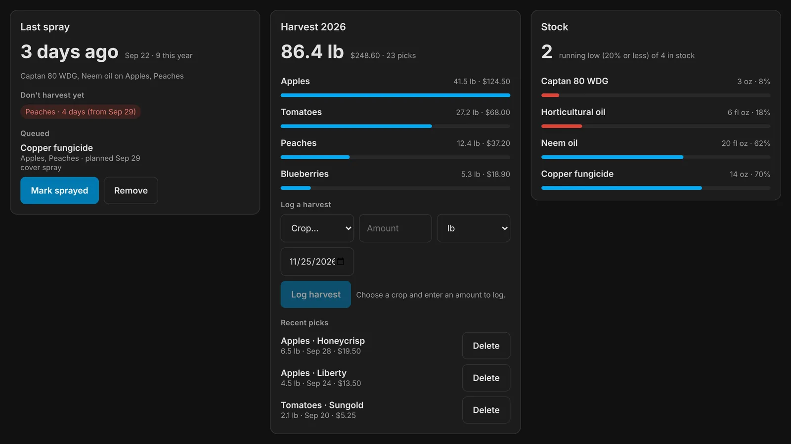
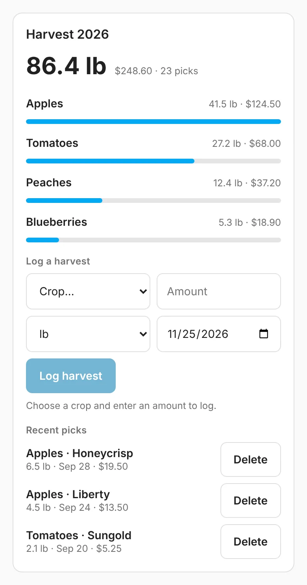

import { Aside } from '@astrojs/starlight/components';

With **Home Assistant integration** on (the default), the add-on deploys the `gardenrx`
integration and Home Assistant offers it under **Settings → Devices & services →
Discovered**. It reads the garden every **60 seconds** (or at once with
`gardenrx.refresh`) and adds three dashboard cards, six sensors and twelve services.

## Dashboard cards

The integration loads the cards on every dashboard — there is no resource to add — and
they appear in the card picker as *GardenRX harvest*, *GardenRX sprays* and *GardenRX
stock*.



### Spray card

```yaml
type: custom:gardenrx-spray-card
```

The last spray (how long ago, its date, how many this year, the products and crops), the
crops you **must not harvest yet** with the days left and the date they clear, and the
**queued sprays** with **Mark sprayed** and **Remove**.

| Option | Default | |
|---|---|---|
| `title` | *Last spray* | The heading; `title: ""` leaves it off |
| `show_queue` | `true` | Show queued sprays |
| `show_phi` | `true` | Show crops inside a pre-harvest interval |
| `volume_gallons` | — | The tank volume to record when you press Mark sprayed |
| `entity` | found by itself | The sensor to read |

### Harvest card

```yaml
type: custom:gardenrx-harvest-card
```

This year's total in weight, its value and the number of picks; a bar per crop; a **Log a
harvest** form (crop, then the varieties that crop has, amount, unit, date); and the
recent picks with **Delete**. Log harvest says what it still needs before it can log.

| Option | Default | |
|---|---|---|
| `title` | *Harvest* and the year | The heading; `title: ""` leaves it off |
| `show_form` | `true` | Show the Log a harvest form |
| `crops` | `6` | How many crops to list |
| `recent` | `5` | How many recent picks to list |
| `entity` | found by itself | The sensor to read |



### Stock card

```yaml
type: custom:gardenrx-inventory-card
```

How many treatments are at 20% or less, then every product in stock, lowest first, with a
level bar. When nothing is low it says *Nothing at 20% or less* and names the lowest.

| Option | Default | |
|---|---|---|
| `title` | *Stock* | The heading; `title: ""` leaves it off |
| `max_items` | `8` | How many products to list |
| `low_only` | `false` | List only the products running low |
| `entity` | found by itself | The sensor to read |

<Aside type="note" title="Two taps for anything that changes the record">
**Delete** on a pick, and **Mark sprayed** and **Remove** on a queued spray, take two taps:
the second within four seconds. A stray touch on a wall tablet can't delete a harvest.
</Aside>

The cards follow your Home Assistant theme, light or dark, use 44 px touch targets and fit
a phone.

### On Morph

When brAIn's [Morph dashboard](/brain/morph/) is present, the add-on copies the cards into
`/config/morph/cards` on every start (turn off **Install the Morph cards** to stop it). In
Morph's `dashboard.yaml` they are:

```yaml
- type: custom:morph-gardenrx-harvest
- type: custom:morph-gardenrx-spray
- type: custom:morph-gardenrx-inventory
```

drawn in Morph's own colours and fonts, with no card chrome of their own.

## Sensors

| Sensor | State | Attributes |
|---|---|---|
| **Harvest this year** | pounds picked this calendar year | `by_crop`, `recent` (each pick with its `id`), `crops` (with varieties), `total_value` |
| **Harvest value this year** | dollars, at each crop's $/lb | |
| **Last spray** | the date | `days_ago`, `products`, `crops`, `queued`, `phi` |
| **Queued sprays** | how many | `queued` (each with its `id`) |
| **Crops in a pre-harvest interval** | how many | `crops` (days left, the date it clears, the product) |
| **Treatments running low** | how many are at 20% or less | `items` (every product in stock) |

A count is valued with the crop's *average weight each* and its $/lb, the same as the
Harvest page.

## Services

Every service **answers with what it did** — call it with a response variable in a script
or automation — and a refusal (a crop nobody is called, a spray already logged) is an
error carrying the reason in a sentence. Crops and products are found by name, part of a
name, or id.

| Service | Fields | What it does |
|---|---|---|
| `gardenrx.log_harvest` | `crop`, `weight`; optional `variety`, `unit` (`lb` default, `oz`, `kg`, `g`, `ct`), `date`, `notes` | Logs a pick. One inside a pre-harvest interval is saved, and the response's `phi_warning` says so. |
| `gardenrx.delete_harvest` | `id` | Deletes a pick. |
| `gardenrx.log_spray` | `product` (one or a list), `crop` (one or a list) **or** `area` (`Orchard`, `Garden`, `Landscape`); optional `rate`, `rate_unit`, `volume_gallons`, `date`, `notes` | A spray that wasn't queued. Without a rate it uses the label's rate for those crops. Clears a queued spray for the same crops and takes what was used out of stock; a product not labelled for a crop is saved and `label_warning` says so. |
| `gardenrx.queue_spray` | the same crops and products; optional `planned_date`, `notes` | Queues a spray: it shows on the Spray page and the spray card. |
| `gardenrx.complete_queued_spray` | `id`; optional `volume_gallons`, `date` | Logs the queued spray, removes it from the queue and takes what it used out of stock — exactly as **Log Spray** in the app. |
| `gardenrx.delete_queued_spray` | `id` | Removes a queued spray. |
| `gardenrx.adjust_inventory` | `product`, and `change` (above zero adds, below zero takes out) **or** `quantity` (how much is on hand); optional `unit` | A product not stocked yet is added, counted in `unit` or the unit its label is sold in. |
| `gardenrx.add_crop` | `name`; optional `crop_group` | A crop the catalog knows gets its group without being told. |
| `gardenrx.add_variety` | `crop`, `name` | Adds a variety. |
| `gardenrx.log_note` | `place`, `note`; optional `date` | A dated line on a place on the Garden Map (a bed, a tree), shown in its Edit dialog. |
| `gardenrx.get_harvests` | optional `crop`, `start`, `end` | Response only: the harvests, newest first, with `totals` per crop and unit. |
| `gardenrx.refresh` | — | Read the garden now instead of at the next poll. |

```yaml
action: gardenrx.log_harvest
data:
  crop: Apples
  variety: Liberty
  weight: 4.5
  unit: lb
response_variable: picked
```

## Recipes

**A button that logs a bowl of cherry tomatoes** (counted, not weighed — the crop's average weight each turns it into pounds):

```yaml
show_name: true
type: button
name: Log 20 tomatoes
tap_action:
  action: perform-action
  perform_action: gardenrx.log_harvest
  data:
    crop: Tomatoes
    weight: 20
    unit: ct
```

**Tell me when something runs low:**

```yaml
alias: Garden – treatment running low
triggers:
  - trigger: numeric_state
    entity_id: sensor.gardenrx_treatments_running_low
    above: 0
actions:
  - action: notify.notify
    data:
      message: >
        Running low:
        {{ state_attr('sensor.gardenrx_treatments_running_low', 'items')
           | selectattr('low') | map(attribute='product') | join(', ') }}
```

**Remind me about a queued spray on its day:**

```yaml
alias: Garden – spray day
triggers:
  - trigger: time
    at: "07:30:00"
conditions:
  - condition: template
    value_template: >
      {{ state_attr('sensor.gardenrx_queued_sprays', 'queued')
         | selectattr('planned_date', 'eq', now().date() | string) | list | count > 0 }}
actions:
  - action: notify.notify
    data:
      message: A spray is planned for today. Check the window in GardenRX first.
```

<Aside type="tip">
Entity ids follow the sensor names (`sensor.gardenrx_last_spray`,
`sensor.gardenrx_queued_sprays`, …). Check yours under **Settings → Devices & services →
GardenRX** if you renamed anything.
</Aside>

## brAIn

When [brAIn](/brain/) is installed:

- It reads **Harvest this year** on every pass of its checks (from the states it already
  fetched — no extra request) and keeps **one fact per crop**: the season's weight, picks,
  value and last pick. The facts expire a few days after the sensor stops reporting, so a
  garden whose integration went away isn't described as it was in August; a new season's
  empty list clears them.
- It can call any `gardenrx.*` service on your say-so, in chat or by voice, through its
  usual [safety rules](/brain/safety/), and reads the reply.
- Its development loop watches the add-on's state and log, so a fault in GardenRX can be
  reported and fixed through the same loop as brAIn's own.
