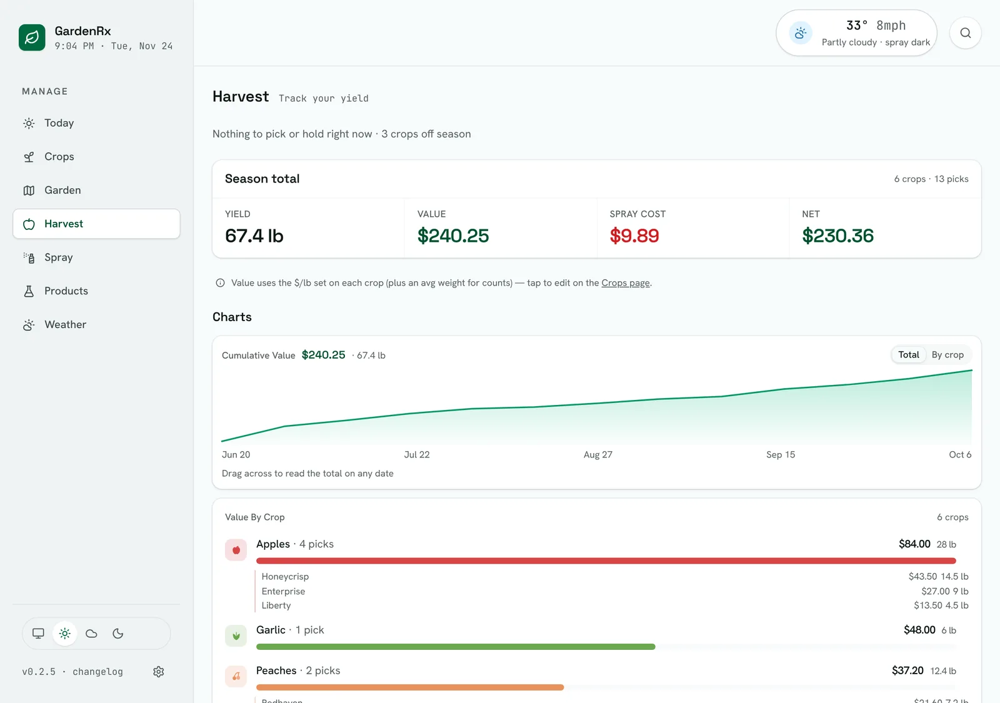

import { LinkCard, CardGrid, Aside } from '@astrojs/starlight/components';

GardenRX tells you what needs spraying, when the weather allows it, what goes in the tank
and when the fruit is safe to pick. It keeps the record of every spray, pick and bottle in
your Home Assistant sidebar.

<Aside type="caution" title="Experimental">
GardenRX changes often. Keep Home Assistant backups (your garden's data is in them) and
read the [changelog](/gardenrx/changelog/) when you update.
</Aside>

## What you can do

### Know what needs doing

| You | GardenRX |
|---|---|
| Open **Today** | One line says it: *All crops protected*, a spray that is due, or *Hold off* with the reason and the next good window. |
| Look under **Needs attention** | Crops whose fungicide or insecticide cover has run out, and crops ready to pick. Tap one to plan its spray. |
| Open it in winter | *While the garden rests* shows a freeze warning, when each crop usually wakes, the last spray and the last pick. |
| Open **Crops** | Every crop's growth stage follows the calendar and your hemisphere, from dormant through bloom to post-harvest. |

### Pick the hour to spray

| You | GardenRX |
|---|---|
| Open **Weather** | A **3-day spray window** rates every daylight hour *Good to spray*, *Caution* or *Hold*, with the reason ("below 40°", "wind", "rain"). |
| Read the banner | It names the next opening, such as *"Next opening: tomorrow 5–6 pm"*. It never calls the dark a good time to spray. |
| Scroll down | The 7-day forecast, rainfall for the week and the last 30 days, and watering advice. |

### Plan a tank mix from the labels

| You | GardenRX |
|---|---|
| Tick crops on **Spray** | Recommends a mix from the products labelled for those crops, using your own stock first. |
| Read the mix | The amount of each product for **your** tank ("Add 4.3 fl oz to 4 gal tank"), the cost and the PPE. |
| Try a mix the label forbids | It is blocked, with the rule: insecticides during bloom, incompatible products, sulfur in heat, high wind. Rotation and weather risks show as warnings. |
| Press **Queue This Spray**, then **Log Spray** once you have sprayed | The spray goes into the history, the pre-harvest clock starts, and what you used comes out of stock. |

### Pick safely and count the harvest

| You | GardenRX |
|---|---|
| Wonder if the peaches can be picked | Today, Harvest and the spray card name every crop inside a **pre-harvest interval**, with the days left and the date it clears. |
| Log a pick by weight or count | The season total, its value at each crop's $/lb, the spray cost and the net update. |
| Open **Harvest** | A running chart of the season's value and a breakdown by crop and variety. |

### Look up a label and keep stock

| You | GardenRX |
|---|---|
| Search **Products** | 256 home-garden and orchard products: active ingredients with FRAC/IRAC groups, signal word, re-entry interval, rain-fast time, temperature range, bee toxicity, PPE, first aid, and the crops each is labelled for. |
| Add what you own to **Your stock** | A level bar for every bottle and bag. Anything at 20% or less turns red. |
| Draw your beds and trees on **Garden** | A map of the garden, with dated notes on any place. |

### Use it from Home Assistant

| You | GardenRX |
|---|---|
| Add a card to a dashboard | Three cards: sprays, harvest and stock. No resource to add. |
| Press **Mark sprayed** or **Log harvest** on a card | The app's record updates, the same as doing it in the app. |
| Call `gardenrx.log_harvest` from a button or script | The pick is logged and the service answers with what it did. Twelve services cover sprays, the queue, stock, crops, varieties and notes. |
| Automate on the *Treatments running low* sensor | A reminder to reorder before the morning you need it. Six sensors in all. |

### Use it with brAIn

GardenRX works without [brAIn](/brain/). With it:

| You | brAIn |
|---|---|
| Ask *"how have the tomatoes done this year?"* | Answers from what it remembers of each crop's season: weight, picks, value and last pick. |
| Say *"log four and a half pounds of Liberty apples"* or *"I just sprayed copper on the peaches"* | Calls the same `gardenrx.*` services an automation would. |
| Turn on the Morph dashboard | The three cards appear in Morph, drawn in Morph's style. |
| Do nothing | brAIn's development loop watches GardenRX's state and log, so a fault can be reported and fixed. |

## What you need

| | |
|---|---|
| **Home Assistant** | OS or Supervised, 2024.1 or newer |
| **Machine** | 64-bit: `amd64` or `aarch64` (Raspberry Pi 4/5 and up) |
| **Location** | Set under **Settings → System → General**. The forecast and the season use it. |
| **Internet** | The forecast comes from Open-Meteo |

Your data stays in one file inside the app and is part of every Home Assistant backup.
Every screen works on a phone and in light, medium and dark themes.

## Where to go next

<CardGrid>
  <LinkCard title="Quick Start" description="Install, add the integration, plan your first spray." href="/gardenrx/quickstart/" />
  <LinkCard title="Using GardenRX" description="Every screen, task by task." href="/gardenrx/guide/" />
  <LinkCard title="Cards, Sensors & Services" description="Card options, every service, automation recipes." href="/gardenrx/home-assistant/" />
  <LinkCard title="Changelog" description="What changed in each release." href="/gardenrx/changelog/" />
</CardGrid>

<Aside type="note" title="A decision aid, not a label">
GardenRX's catalog and rules are built from product labels and published guidance. The
label on the product in your hand is the law. Read it before every spray.
</Aside>
