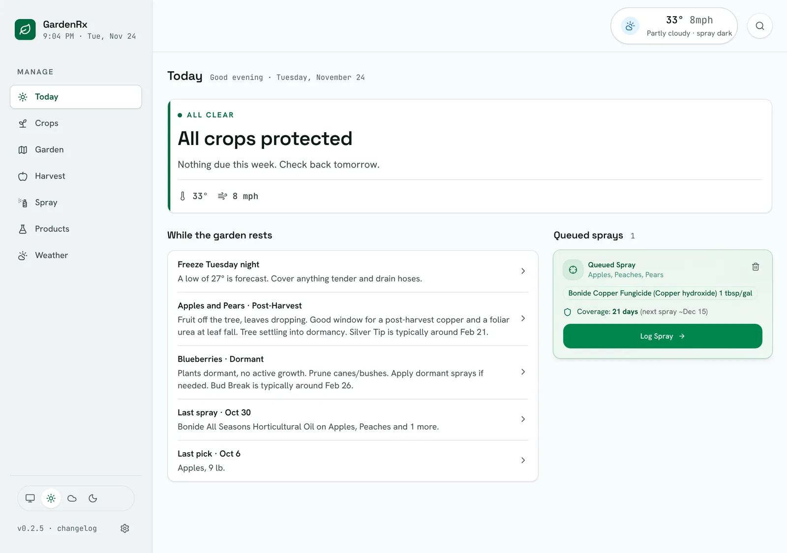
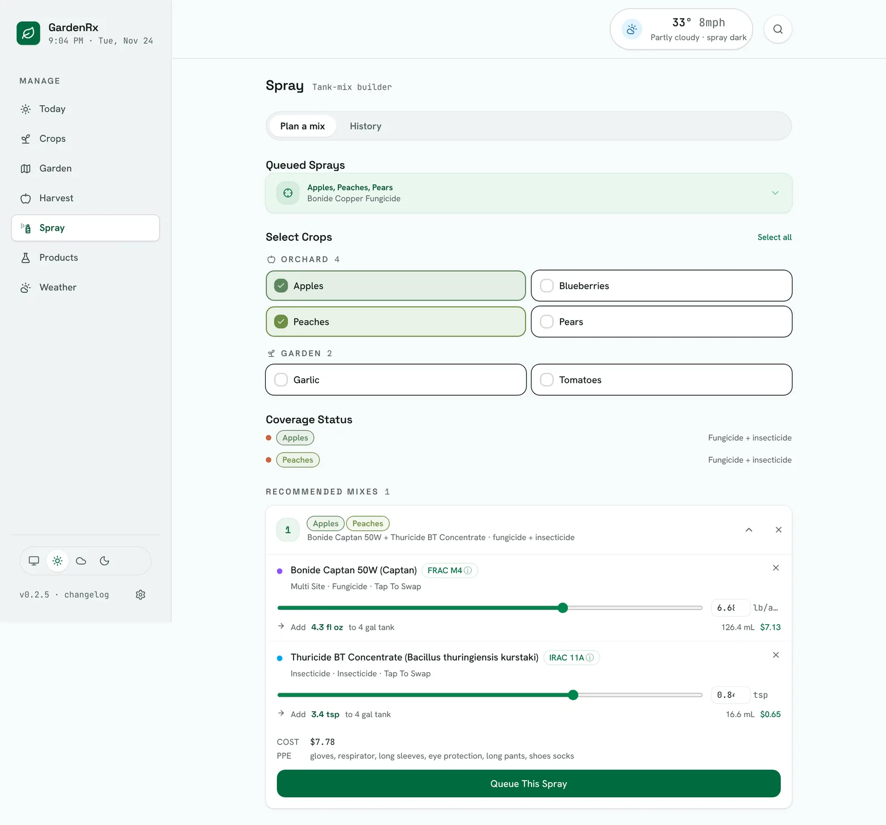
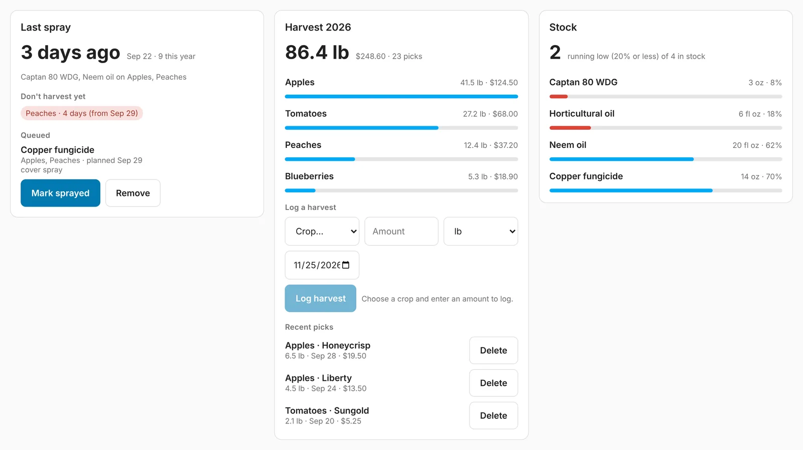

import { Steps, Aside } from '@astrojs/starlight/components';

Go from the app store to a planned spray in about ten minutes.



## Before you start

| | |
|---|---|
| **Home Assistant** | OS or Supervised, 2024.1 or newer |
| **Machine** | `amd64` or `aarch64` |
| **Location and time zone** | Set under **Settings → System → General**. GardenRX uses them for the forecast, the time of day and the season. |

## Install

<Steps>

1. **Add the repository.** In Home Assistant open **Settings → Add-ons → Add-on Store →
   ⋮ → Repositories** and add:

   ```text title="Repository URL"
   https://github.com/bruhautomation/BRUH-HA-Apps
   ```

2. **Install GardenRX** from the store and press **Start**. **GardenRX** appears in the
   sidebar with a sprout icon.

3. **Restart Home Assistant once** (**Settings → System → Restart**). This loads the
   `gardenrx` integration the app installed.

4. **Add the integration.** Under **Settings → Devices & services**, GardenRX is waiting
   under *Discovered*. Press **Add**. You now have six sensors, twelve services and three
   dashboard cards.

</Steps>

<Aside type="tip">
Later updates ask for a Home Assistant restart only when the integration's code changed.
The app's log says so. A change to the cards needs only a page reload.
</Aside>

## Set up your garden

The product catalog is loaded on the first start. Your crops, sprays, harvests and stock
start empty.

<Steps>

1. **Add your crops.** Open **Crops → Add crop** and add what you grow: Apples, Peaches,
   Blueberries, Tomatoes. A crop the catalog knows gets its crop group by itself. The group
   sets its season and which labels apply.

2. **Add varieties.** Open a crop and add its varieties, such as *Liberty* or *Redhaven*.
   Set the crop's **$/lb** so the Harvest page can value your picks. For crops you count
   instead of weigh, also set an average weight each.

3. **Stock your shelf.** On **Products → Your stock**, search for the products you own and
   add them. Set the bottle or bag size and how much is left.

4. **Set your tank size.** Open Settings (the gear at the bottom of the sidebar) and set
   your **Sprayer** tank size in gallons. Every dose is worked out for that tank.

5. **Plan a spray.** Open **Spray** and tick the crops you want to spray. Check the
   recommended mix: the amount of each product for your tank, the cost, the PPE and any
   warning. Press **Queue This Spray**.

6. **Log it.** When you have sprayed, press **Log Spray** on the queued spray, on Today or
   on the Spray page. The spray goes into the history, the pre-harvest clock starts for
   those crops, and what you used comes out of stock.

</Steps>



## Put it on a dashboard

Edit any dashboard, press **Add card** and search for *GardenRX*. Or paste one of these:

```yaml
type: custom:gardenrx-spray-card
```

```yaml
type: custom:gardenrx-harvest-card
```

```yaml
type: custom:gardenrx-inventory-card
```

There is no resource to add. The integration loads the cards on every dashboard.



## Next

- [Using GardenRX](/gardenrx/guide/): every screen, task by task.
- [Cards, sensors and services](/gardenrx/home-assistant/): card options, every service
  with its fields, and automation recipes.
