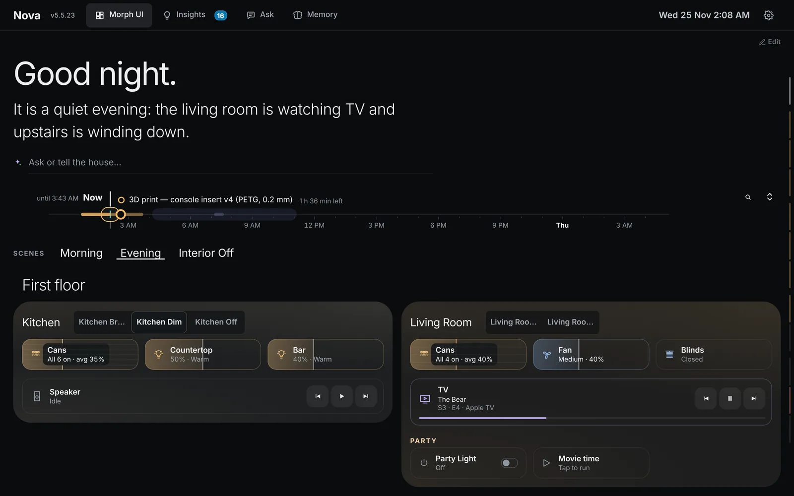

import { Card, CardGrid, LinkCard, Steps, Aside } from '@astrojs/starlight/components';
import { APP_LIST } from '../../catalog.mjs';

Everything here installs from **one repository** into Home Assistant's app store, runs on
your own hardware, and shows up in your sidebar. brAIn is the mind; the rest give it hands —
each one works on its own, and each one gets better when brAIn is installed beside it.



## Install the repository

<Steps>

1. In Home Assistant, open **Settings → Apps** (called **Add-ons** on older versions) and
   then the **App Store** (Add-on Store).

2. Open the **⋮** menu in the top-right corner, choose **Repositories**, and add:

   ```text
   https://github.com/bruhautomation/BRUH-HA-Apps
   ```

3. Close the dialog. A **BRUH HA Apps** section appears in the store with every app below.
   Install the ones you want, then follow each app's Quick Start.

</Steps>

<Aside type="tip">
Start with **brAIn**. Two apps (BRUH Cooking, BRUH Browser) require it, and most of the others
give brAIn tools of their own — "what's printing?", "make a shelf label for the
batteries", "play the party playlist with lights" — once both are installed.
</Aside>

## The apps

<CardGrid>
	{APP_LIST.map((app) => (
		<LinkCard
			title={app.experimental ? `${app.name} (experimental)` : app.name}
			href={app.href}
			description={`${app.tagline} ${app.blurb}`}
		/>
	))}
</CardGrid>

## At a glance

| App | What it is for | Needs | Hardware |
|---|---|---|---|
| [**brAIn**](/brain/) | Claude with the full run of Home Assistant: the Morph dashboard, a Resident that notices and investigates, memory, voice, chat and a terminal | A Claude Pro or Max plan, or an Anthropic API key | amd64, aarch64 |
| [**BRight**](/bright/) | Music-driven light shows on LIFX bulbs and switches, in sync with your speaker | LIFX bulbs on the LAN, a media player, music under `/media` | amd64, aarch64 |
| [**BRUH Print**](/bruh-print/) | Design and print labels on a DYMO LabelWriter from anywhere | A USB DYMO LabelWriter plugged into the HA machine | amd64, aarch64 |
| [**BRUH Minecraft**](/bruh-minecraft/) | A Java Edition server with Bedrock cross-play, world backups in git and an add-on browser | Enough RAM for the worlds you run | amd64, aarch64 |
| [**BRUH Bambu Studio**](/bruh-bambu-studio/) | Bambu Studio in the sidebar, Bambu Lab printers over the LAN, parts designed with brAIn | A Bambu Lab printer in LAN mode | amd64 only |
| [**GardenRX**](/gardenrx/) | What to spray, when, and how much — for a home orchard and garden | Nothing else | amd64, aarch64 |
| [**BRUH Task Manager**](/bruh-task-manager/) | CPU, memory, network and disk per app, and per process if you allow it | Home Assistant OS or Supervised | amd64, aarch64 |
| [**BRUH Cooking**](/bruh-cooking/) | Breville+ and Sage cooking appliances in Home Assistant and brAIn | **brAIn**, a Breville+ account | amd64, aarch64 |
| [**BRUH Browser**](/bruh-browser/) | A real Chrome that brAIn drives to run errands on websites, stopping before any purchase | **brAIn**, a paid Claude plan | amd64 only |

Every app is listed as *experimental* in Home Assistant's store, which is Home Assistant's
way of saying it is not an official add-on. The three marked experimental above are also the
newest: they work, and they are moving fastest.

## How they work together

<CardGrid>
  <Card title="One brAIn, many hands" icon="puzzle">
    When brAIn and another app are both installed, brAIn picks up that app's tools on its
    own — Bambu's print status and controls, Print's labels, BRight's shows, Minecraft's
    server and companion, Cooking's appliances, Browser's errands. Ask in the chat, by voice
    or from an automation.
  </Card>
  <Card title="One dashboard" icon="laptop">
    Apps that publish cards (BRUH Print, GardenRX, BRUH Bambu Studio, BRUH Minecraft) offer
    them to [Morph](/brain/morph/), brAIn's dashboard, as well as to ordinary Home Assistant
    dashboards.
  </Card>
  <Card title="Safety travels with the tool" icon="approve-check">
    Each app decides what brAIn and voice may do with it. Voice may start a print but not
    send G-code; BRUH Browser can fill a cart but never pay for one you have not heard and
    approved. See [brAIn's safety model](/brain/safety/).
  </Card>
  <Card title="Your house stays yours" icon="seti:lock">
    Everything runs on your Home Assistant machine. What leaves it — Claude's requests,
    Bambu's or Breville's own cloud where the device needs it — is spelled out on each app's
    page, and brAIn's optional development loop redacts before anything is sent.
  </Card>
</CardGrid>

## Source, issues and updates

All nine apps live in
[bruhautomation/BRUH-HA-Apps](https://github.com/bruhautomation/BRUH-HA-Apps) on GitHub.
Updates arrive through Home Assistant's normal update flow; each app's page has its own
changelog. Found a bug or want a feature?
[Open an issue](https://github.com/bruhautomation/BRUH-HA-Apps/issues).
