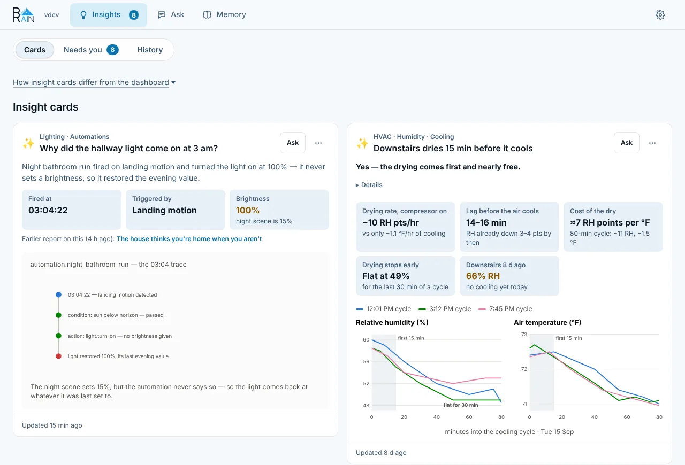
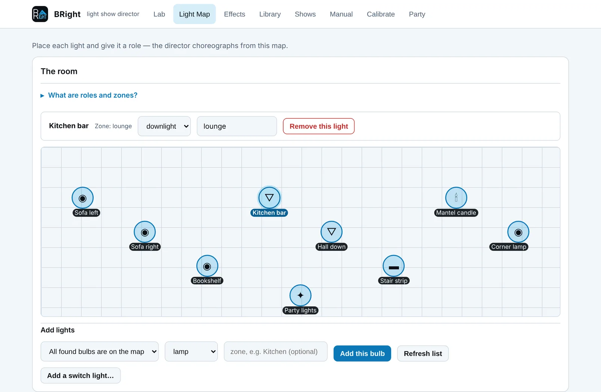
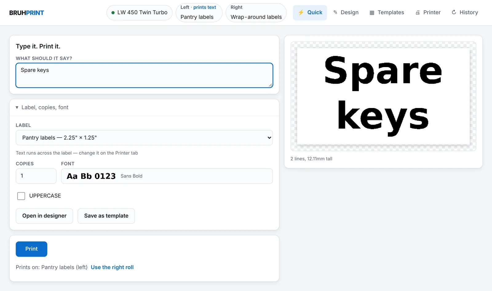
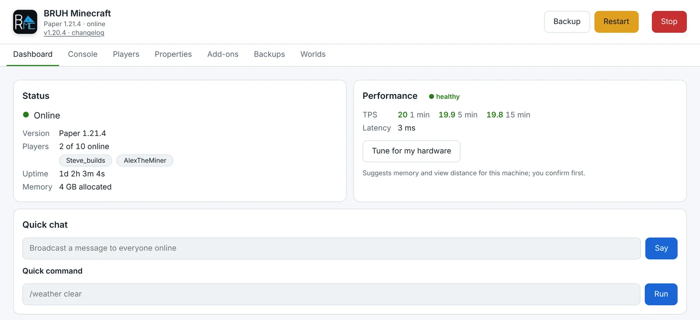
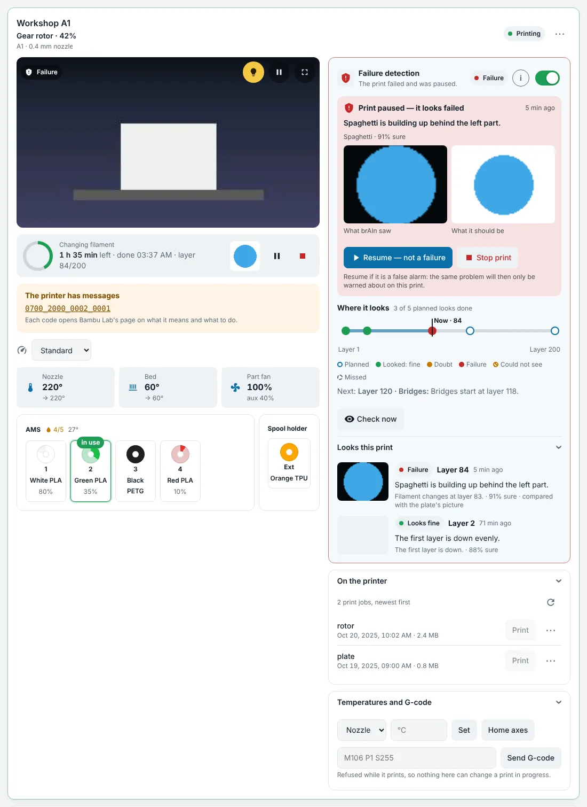
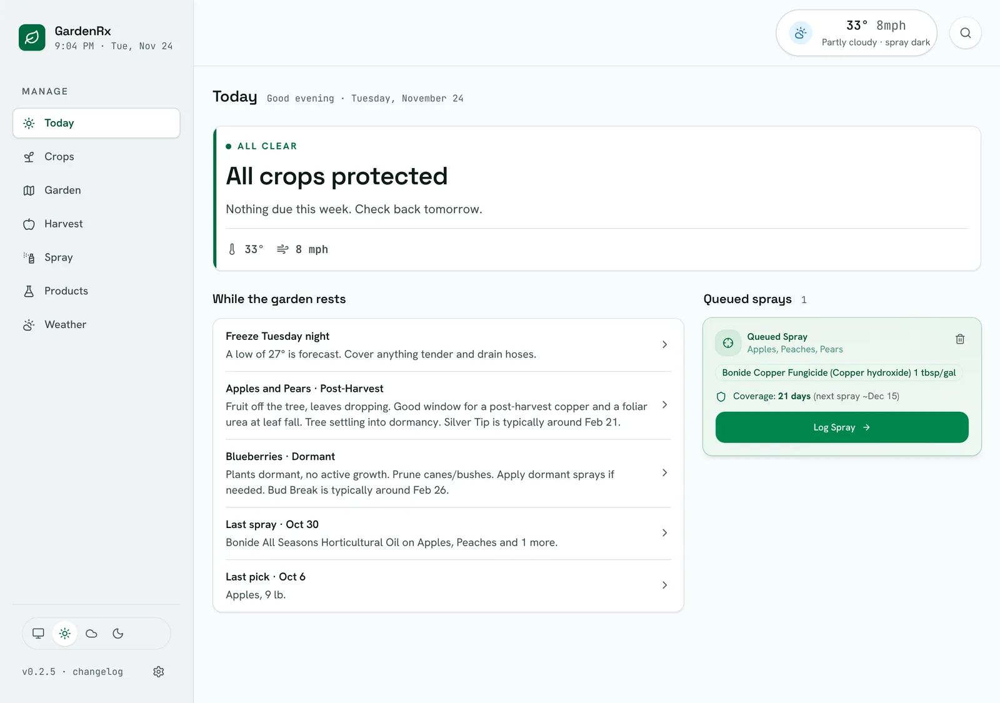
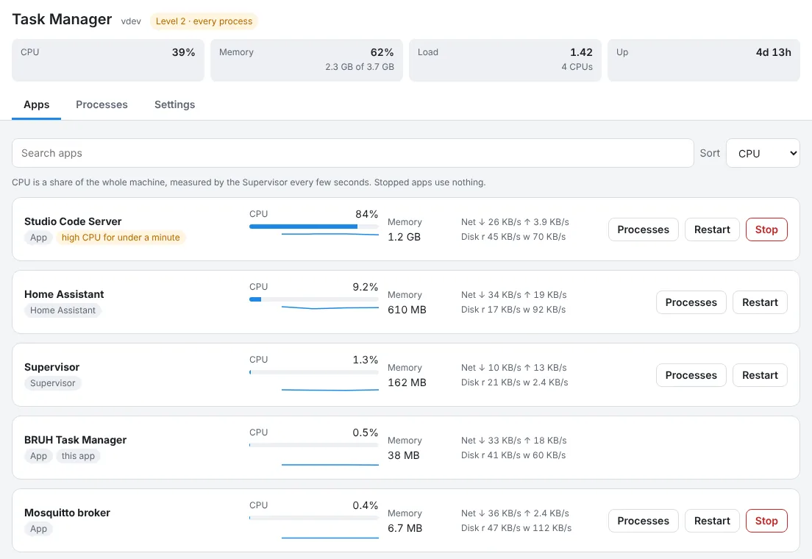
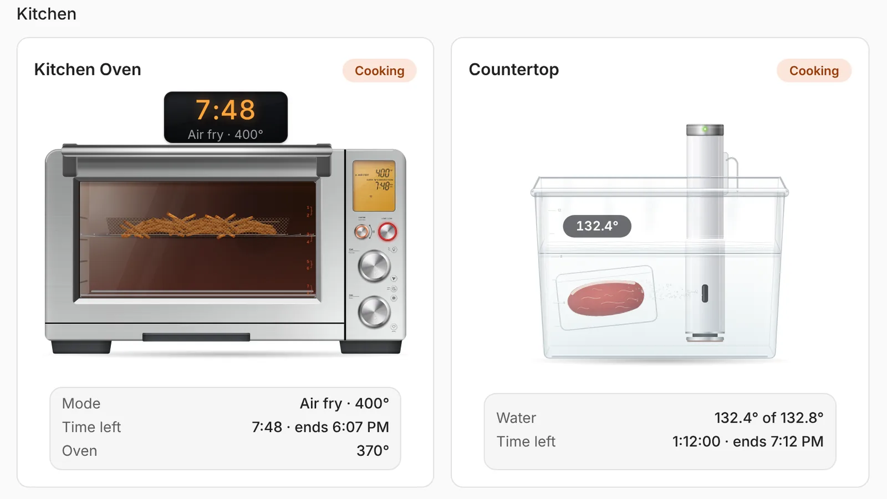
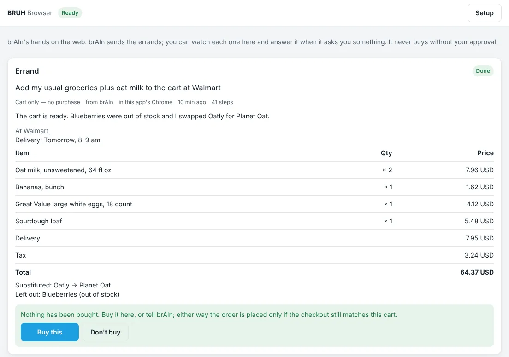

import { Card, CardGrid, LinkCard, Steps, Aside } from '@astrojs/starlight/components';

Everything here installs from **one repository** into Home Assistant's app store, runs on
your own hardware, and shows up in your sidebar. brAIn is the mind; the rest give it hands —
each one works on its own, and each one gets better when brAIn is installed beside it.


## Install the repository

<Steps>

1. In Home Assistant, open **Settings → Apps** (called **Add-ons** on older versions) and
   then the **App Store** (Add-on Store).

2. Open the **⋮** menu in the top-right corner, choose **Repositories**, and add:

   ```text
   https://github.com/bruhautomation/BRUH-HA-Apps
   ```

3. Close the dialog. A **BRUH HA Apps** section appears in the store with every app below.
   Install the ones you want, then follow each app's Quick Start.

</Steps>

<Aside type="tip">
Start with **brAIn**. Two apps (BRUH Cooking, BRUH Browser) require it, and most of the others
give brAIn tools of their own — "what's printing?", "make a shelf label for the
batteries", "play the party playlist with lights" — once both are installed.
</Aside>

## What you can do with each app

### brAIn

Claude with the run of Home Assistant. It notices, investigates, explains, remembers and fixes, and it asks before it changes anything.



- Ask in chat or by voice: *"why did the hallway light come on at 3 am?"* and get the automation trace that explains it.
- Open **Needs you** and answer the decisions it found on its own: a dead battery, a stuck automation, a heating schedule that fights itself.
- Use **Morph**, a dashboard that lays itself out by what matters right now and says why. Hold any card and **Tell brAIn** to change it.
- Let it learn the house: one memory of rooms, devices and habits that you can read and delete fact by fact.

**Needs:** A Claude Pro or Max plan, or an Anthropic API key. [Open the brAIn docs →](/brain/)

### BRight

Music-driven light shows on the lights you already own, in sync with the speaker that is playing.



- Say *"start party mode"*. Your set plays and every track gets its own show.
- Type *"the chorus needs more movement"* and press **Revise with Claude**. Every version is kept.
- Play the room live from your phone on the **Manual** tab: tap bulbs on the beat, record loops, hit **DROP**.
- Start a show from an automation with `bright.start_show`.

**Needs:** LIFX bulbs on the LAN or any switch, a media player, music under `/media`. [Open the BRight docs →](/bright/)

### BRUH Print

Design and print labels on a DYMO LabelWriter from anywhere in the house.



- Type one word and print. The text is fitted to the label for you.
- Design a label with text, shapes, barcodes and images in the full designer.
- Fill in a template: the same layout, new words each time.
- Print from a dashboard card or an automation, and pick the roll on a Twin Turbo.

**Needs:** A USB DYMO LabelWriter plugged into the Home Assistant machine. [Open the BRUH Print docs →](/bruh-print/)

### BRUH Minecraft

A Minecraft Java Edition server the whole family can run, with Bedrock cross-play.



- Start, stop and watch the server from the sidebar, with a live console and player list.
- Back up every world to git and restore any earlier version.
- Browse and install plugins, data packs and mods from Modrinth. iPad players get them with nothing to install.
- Automate the house from the game, and let an in-game brAIn companion play along.

**Needs:** Enough RAM for the worlds you run. [Open the BRUH Minecraft docs →](/bruh-minecraft/)

### BRUH Bambu Studio

Bambu Studio in your sidebar and Bambu Lab printers over the LAN.



- Open Bambu Studio in the browser. Nothing to install on your computer.
- Send a file to a printer. It is sliced if needed, uploaded and started, and you watch it from Home Assistant.
- Describe a part to brAIn, see it, and print it.
- Get told when a print looks like it is failing.

**Needs:** A Bambu Lab printer in LAN mode; amd64 only. [Open the BRUH Bambu Studio docs →](/bruh-bambu-studio/)

### GardenRX

What to spray, when, and how much, for a home orchard and garden.



- Open **Today** to see what needs doing and whether the weather allows it.
- Plan a spray. Mixes that conflict or would harm pollinators are blocked before you queue them.
- Get the tank mix worked out for your sprayer, and keep stock and harvests in one place.
- Put the spray window, stock and harvest on a dashboard with the included cards.

**Needs:** Nothing else. [Open the GardenRX docs →](/gardenrx/)

### BRUH Task Manager (experimental)

Task Manager for Home Assistant OS: what the machine is doing, app by app.



- See CPU, memory, network and disk for every app.
- Switch on process view to see every process, grouped by the app it belongs to.
- **Restart**, **Stop** or **Start** an app, or end a single process inside one.
- Get a binary sensor that turns on when an app runs away.

**Needs:** Home Assistant OS or Supervised. [Open the BRUH Task Manager docs →](/bruh-task-manager/)

### BRUH Cooking (experimental)

Breville+ and Sage cooking appliances in Home Assistant and brAIn.



- Ask brAIn to start the sous vide or check how the oven is doing.
- Watch each appliance in a panel drawn for it: Joule, Joule Turbo and the Joule Oven Air Fryer Pro.
- Automate on a cook finishing or an appliance going offline.

**Needs:** **brAIn** and a Breville+ account. [Open the BRUH Cooking docs →](/bruh-cooking/)

### BRUH Browser (experimental)

brAIn's hands on the web: a real Chrome it drives to run errands.



- Ask brAIn to fill a grocery cart or look something up on a site that has no API.
- Watch it work in the sidebar, one errand at a time.
- Approve the cart yourself. It never buys anything you have not heard and approved.

**Needs:** **brAIn** and a paid Claude plan; amd64 only. [Open the BRUH Browser docs →](/bruh-browser/)

## At a glance

| App | What it is for | Needs | Hardware |
|---|---|---|---|
| [**brAIn**](/brain/) | Claude with the full run of Home Assistant: the Morph dashboard, a Resident that notices and investigates, memory, voice, chat and a terminal | A Claude Pro or Max plan, or an Anthropic API key | amd64, aarch64 |
| [**BRight**](/bright/) | Music-driven light shows on LIFX bulbs and switches, in sync with your speaker | LIFX bulbs on the LAN, a media player, music under `/media` | amd64, aarch64 |
| [**BRUH Print**](/bruh-print/) | Design and print labels on a DYMO LabelWriter from anywhere | A USB DYMO LabelWriter plugged into the HA machine | amd64, aarch64 |
| [**BRUH Minecraft**](/bruh-minecraft/) | A Java Edition server with Bedrock cross-play, world backups in git and an add-on browser | Enough RAM for the worlds you run | amd64, aarch64 |
| [**BRUH Bambu Studio**](/bruh-bambu-studio/) | Bambu Studio in the sidebar, Bambu Lab printers over the LAN, parts designed with brAIn | A Bambu Lab printer in LAN mode | amd64 only |
| [**GardenRX**](/gardenrx/) | What to spray, when, and how much — for a home orchard and garden | Nothing else | amd64, aarch64 |
| [**BRUH Task Manager**](/bruh-task-manager/) | CPU, memory, network and disk per app, and per process if you allow it | Home Assistant OS or Supervised | amd64, aarch64 |
| [**BRUH Cooking**](/bruh-cooking/) | Breville+ and Sage cooking appliances in Home Assistant and brAIn | **brAIn**, a Breville+ account | amd64, aarch64 |
| [**BRUH Browser**](/bruh-browser/) | A real Chrome that brAIn drives to run errands on websites, stopping before any purchase | **brAIn**, a paid Claude plan | amd64 only |

Every app is listed as *experimental* in Home Assistant's store, which is Home Assistant's
way of saying it is not an official add-on. The three marked experimental above are also the
newest: they work, and they are moving fastest.

## How they work together

<CardGrid>
  <Card title="One brAIn, many hands" icon="puzzle">
    When brAIn and another app are both installed, brAIn picks up that app's tools on its
    own — Bambu's print status and controls, Print's labels, BRight's shows, Minecraft's
    server and companion, Cooking's appliances, Browser's errands. Ask in the chat, by voice
    or from an automation.
  </Card>
  <Card title="One dashboard" icon="laptop">
    Apps that publish cards (BRUH Print, GardenRX, BRUH Bambu Studio, BRUH Minecraft) offer
    them to [Morph](/brain/morph/), brAIn's dashboard, as well as to ordinary Home Assistant
    dashboards.
  </Card>
  <Card title="Safety travels with the tool" icon="approve-check">
    Each app decides what brAIn and voice may do with it. Voice may start a print but not
    send G-code; BRUH Browser can fill a cart but never pay for one you have not heard and
    approved. See [brAIn's safety model](/brain/safety/).
  </Card>
  <Card title="Your house stays yours" icon="seti:lock">
    Everything runs on your Home Assistant machine. What leaves it — Claude's requests,
    Bambu's or Breville's own cloud where the device needs it — is spelled out on each app's
    page, and brAIn's optional development loop redacts before anything is sent.
  </Card>
</CardGrid>

## Source, issues and updates

All nine apps live in
[bruhautomation/BRUH-HA-Apps](https://github.com/bruhautomation/BRUH-HA-Apps) on GitHub.
Updates arrive through Home Assistant's normal update flow; each app's page has its own
changelog. Found a bug or want a feature?
[Open an issue](https://github.com/bruhautomation/BRUH-HA-Apps/issues).
